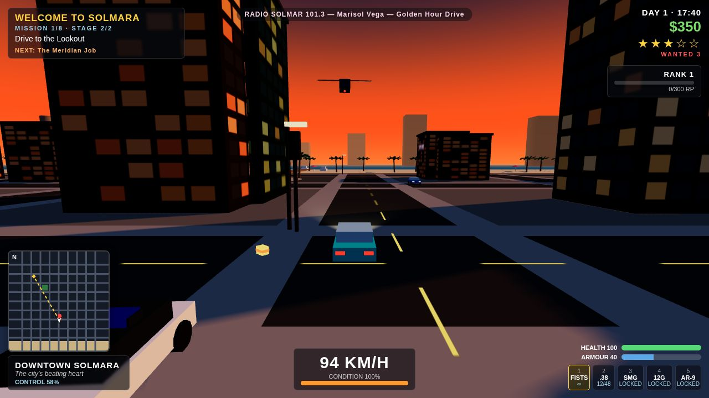

[](https://make.fun/bounty/gta6-01?utm_source=github&utm_medium=readme&utm_campaign=gta6-01)
[](https://make.fun/bounty/gta6-01?utm_source=github&utm_medium=readme&utm_campaign=gta6-01)
[](https://make.fun/bounty/gta6-01?utm_source=github&utm_medium=readme&utm_campaign=gta6-01)
[](https://make.fun/bounty/gta6-01?utm_source=github&utm_medium=readme&utm_campaign=gta6-01)
# SOLMARA — Heat on the Shore

An original open-world crime game in a sun-soaked coastal city at golden
hour, built with three.js for make.fun's **gta6-01** bounty.



## The game

You arrive in Solmara with $350 and no friends. Meet Lina at the Marina,
run your first job, steal cars, outrun the law, and climb from nobody to
king of the shore.

- **Open city** — dense mid-rise streets with neon shop signs, a beach and
  boardwalk, palms, moving traffic, pedestrians, traffic lights, and a
  volcano on the horizon.
- **On foot and by car** — third-person walking with mouse look and jumping;
  steal any parked car with F, chase camera, speed + condition readout.
- **Missions and story** — data-driven mission system with dialogue,
  stage objectives, payouts and RP. All 8 story jobs are playable
  end-to-end ($500 to $50,000): Welcome to Solmara, The Meridian Job,
  Ember Run, Boardwalk Heat, The Volcano Club, Salt & Chrome,
  The Last Ferry, King of the Shore.
- **Combat** — fists (click to punch) and a working .38 revolver
  (slot 2, 12-round clip, R to reload, hit-scan with muzzle flash and
  tracer). Ammo boxes around the city refill the reserve with E.
  Hitting pedestrians raises the wanted level.
- **Wanted system** — stars rise on crime; police cars pursue at 2+ stars
  and a helicopter circles at 3+.
- **Full HUD** — mission card with stages, clock, money, wanted stars,
  rank/RP progress, weapon slots with live ammo, health/armour, minimap
  with route line, district labels, and a radio station.
- **Pause menu** — full island map (districts with control %, player
  position, mission marker, discovered districts), story mission list,
  career stats, controls.
- **Autopilot (F9)** — drives the car along the street grid to the active
  mission marker, or wanders the city when there is no mission. Any
  driving input cancels it.

## Controls

| Key | Action |
|-----|--------|
| WASD | Move / Drive |
| Mouse | Look |
| Click | Punch / Shoot (on foot) |
| F | Steal / Exit car |
| E / Enter | Talk / Interact / Advance dialogue / Pick up ammo |
| Space | Jump / Handbrake |
| Shift | Sprint |
| R | Reload |
| 1–5 | Weapons |
| F9 | Autopilot |
| Esc / P | Pause |

## Play it

```sh
node serve.ts
# open http://localhost:8080
```

The game is static files under `game/` with no build step and no network
requests — every script and asset is a file under `game/`. three.js is
vendored as `game/vendor/three.module.min.js`.

## Build the entry

```sh
mkdir -p out && MAKEFUN_OUTPUT_DIR=out node main.ts
```

`main.ts` copies `game/` and `screenshots/` into the output directory and
writes `dossier.json` with the kit's `buildDossier` (from
`vendor/makefun-game.ts`, the kit's copy, unchanged).

## Layout

- `game/index.html` — page, import map, HUD DOM, menus
- `game/src/main.js` — bootstrap, game loop, cameras, poses
- `game/src/city.js` — the open world: streets, buildings, beach, sky
- `game/src/player.js` — on-foot character + movement
- `game/src/vehicles.js` — parked cars, traffic, driving
- `game/src/pedestrians.js` — sidewalk walkers
- `game/src/missions.js` — mission data + stage machine + dialogue
- `game/src/police.js` — wanted level, pursuit, helicopter
- `game/src/combat.js` — fists + .38, ammo pickups, muzzle flash/tracer
- `game/src/autopilot.js` — F9 self-driving along the street grid
- `game/src/islandmap.js` — pause-menu full island map
- `game/src/hud.js` — HUD + minimap
- `game/src/audio.js` — WebAudio synth (blips, jingle, engine hum)
- `screenshots/` — real captures from the running game

## Originality

Every name, character, place, story beat and line of dialogue is original
to this entry. No assets, names, or music from any commercial game.

## License

MIT — see LICENSE.
